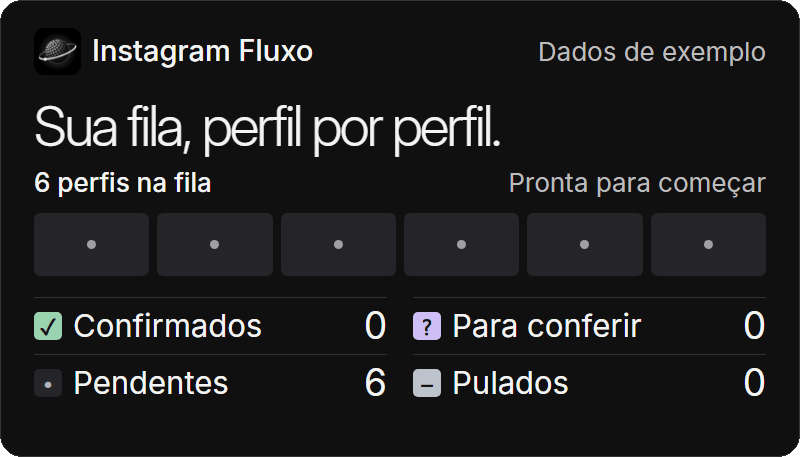
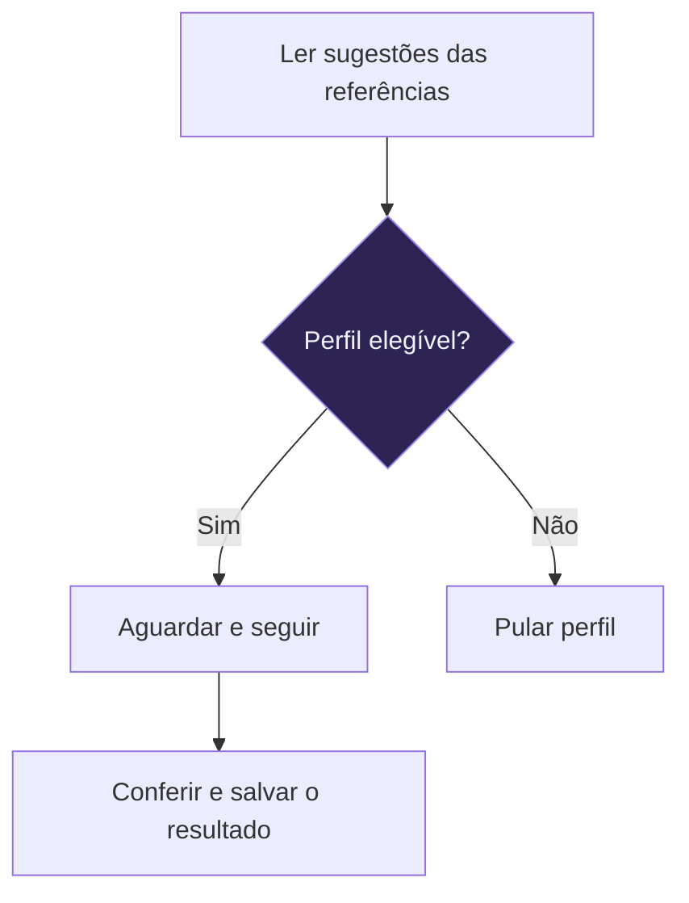
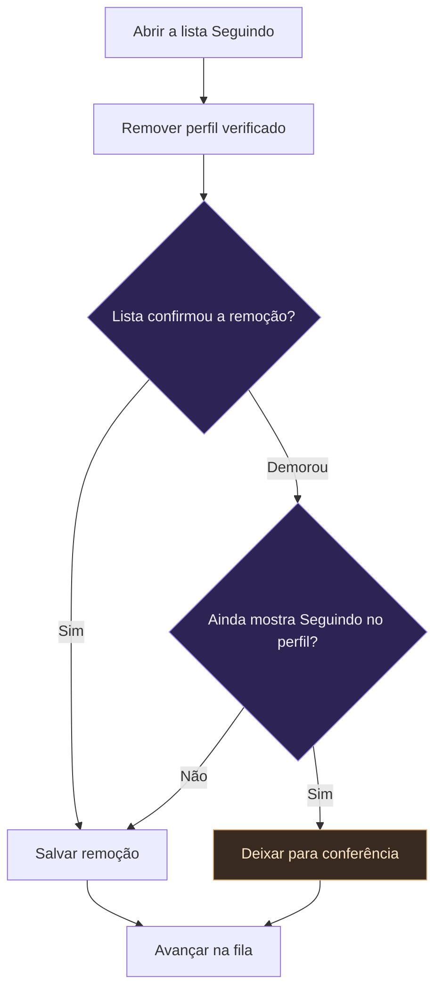

  

<h1 align="center">Instagram Fluxo</h1>

  
  
  

  
  
  
  
  
  

Sugestões, filas e histórico local para administrar quem você segue no Instagram.

  <a href="#a-fila-em-ação">Demonstração</a> · <a href="#como-funciona">Fluxos</a> · <a href="#instalação-local">Instalação</a>

## A fila em ação

  <picture>
    <source media="(prefers-reduced-motion: reduce)" srcset="assets/fila-em-acao.png">
    
  </picture>

[Ver gráfico estático](assets/fila-em-acao.png)

## Como funciona

### Seguir sugestões

Parar de seguir todos

Um aviso de restrição do Instagram ou um resultado que a extensão não consegue conferir pausa a fila e preserva o progresso.

## O que faz

- Segue perfis a partir das sugestões de três referências configuráveis, com alternativa pelos seguidores das referências.
- Pula perfis que seguem você, contas já processadas e os perfis de referência.
- Oferece agente de IA opcional com BYOK e fallback entre OpenAI, Claude, Gemini e OpenRouter.
- Executa unfollow de todas as contas em fila, com parada, histórico e conferência de resultados atrasados.
- Mostra a fila em carrossel com miniaturas locais e os cards expansíveis de sugestões e histórico.
- Mantém filas, tentativas e histórico no Chrome. O coletor Windows opcional grava diagnósticos em JSONL.

## Instalação local

1. Clone ou baixe este repositório.
2. Abra `chrome://extensions` e ative **Modo do desenvolvedor**.
3. Clique em **Carregar sem compactação** e selecione `outputs/instagram-fluxo`.
4. Abra seu perfil no Instagram e clique no ícone da extensão.
5. Carregue a conta, salve as três referências e escolha a ação desejada.

Ao atualizar, recarregue a mesma instalação para conservar seus dados locais.

## Fluxo e dados

O modo automático usa o intervalo e as pausas configurados. Cada tentativa enviada conta na cota local. O total de ações bem-sucedidas inclui apenas resultados confirmados.

No unfollow, uma confirmação atrasada é conferida no próprio perfil. Se ele ainda aparecer como seguido, a fila registra a pendência e continua pelos demais. Uma nova execução pode conferir os pendentes novamente. A conclusão exige uma contagem nativa de zero e o salvamento do resultado.

As chaves ficam no cofre local. Ao ativar a IA, os dados públicos necessários à análise são enviados ao provedor escolhido. Logs e dados gerados durante o uso ficam fora deste repositório.

## Logs em arquivo no Windows

O histórico funciona no Chrome. Para gravar diagnósticos em `logs/instagram-fluxo`, o coletor Windows incluso precisa do Python e de um vínculo com o ID da extensão. O instalador e o coletor vêm configurados para a instalação original. Uma instalação nova precisa configurar o próprio ID antes de registrar o coletor.

Detalhes de funcionamento estão no [guia da extensão](outputs/instagram-fluxo/LEIA-ME.md).

---

Desenvolvido por <a href="https://upaiva.dev">mPaiva_</a>

