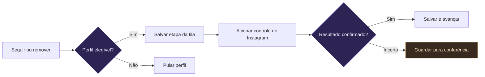

<p align="center">
  
</p>

<h1 align="center">Instagram Fluxo</h1>

<p align="center">Extensão local para organizar sugestões, revisar a lista Seguindo e acompanhar filas no Chrome.</p>

<p align="center">
  <a href="https://github.com/EoPaiva/instagram-fluxo/releases/latest"></a>
  <a href="#instalação-local"></a>
  <a href="https://upaiva.dev/"></a>
</p>

<p align="center">
  
  
  
  
  
  
</p>

<p align="center">
  <a href="#a-fila-em-ação">Demonstração</a> · <a href="#como-funciona">Fluxos</a> · <a href="#instalação-local">Instalação</a> · <a href="#desenvolvimento">Desenvolvimento</a>
</p>

## Correções da 3.9.1

- **Limpa Perfil** conta apenas os perfis identificados na leitura atual. Quando o Instagram carrega parte da lista, o painel mostra o progresso real e mantém a lista branca.
- **Parar de seguir** pausa na lista Seguindo quando faltam perfis, com o progresso salvo. Para abrir os perfis pendentes, ative **Conferir perfis individualmente se a lista falhar**.

## A fila em ação

<p align="center">
  <picture>
    <source media="(prefers-reduced-motion: reduce)" srcset="assets/fila-em-acao.png">
    
  </picture>
</p>

[Ver gráfico estático](assets/fila-em-acao.png)

## Como funciona

| Área | O que você faz |
| --- | --- |
| **Seguir** | Configure três referências, consulte as sugestões salvas e escolha um lote ou uma quantidade para o modo automático. Se quiser, use IA com uma chave própria para ordenar os candidatos. |
| **Parar de seguir** | No **Limpa Perfil**, revise até 200 contas por página e confirme as que deseja remover. Em **Parar de seguir todos**, a extensão percorre a lista preservando os perfis protegidos. |
| **Barra lateral** | Veja o perfil atual, próximos nomes e progresso. Pare a fila, copie seu resumo ou abra **Seguir**, **Parar de seguir** e **Lista branca**. |
| **Dados locais** | Consulte o histórico, gerencie a lista branca e salve ou restaure backups por conta. |
| **Meta Insights** | Consulte métricas da sua conta profissional com um token usado só para a consulta. |



- **Seguir** exclui quem já segue você, os perfis de referência e as contas já seguidas pelo fluxo. A coleta e a execução podem ser iniciadas separadamente.
- **Lista branca** vale para as duas opções de remoção, inclusive quando o fluxo precisa consultar o inventário ou o histórico salvo. O Limpa Perfil aceita a leitura da lista Seguindo ou a importação de uma exportação do Instagram.
- **Parada e retomada** preservam os resultados confirmados. Use **Retomar fila salva** no modo automático de seguir ou **Retomar lote salvo** no Limpa Perfil. Se encontrar uma restrição do Instagram, a extensão pausa as ações.
- **IA opcional** usa o cofre local e pode trocar entre OpenAI, Gemini, OpenRouter e Claude em caso de cota esgotada ou credencial recusada. Os dados públicos necessários à análise são enviados ao provedor escolhido.

## Instalação local

1. Baixe e extraia o ZIP da [versão mais recente](https://github.com/EoPaiva/instagram-fluxo/releases/latest).
2. Abra `chrome://extensions`, ative o **Modo do desenvolvedor** e escolha **Carregar sem compactação**.
3. Selecione a pasta extraída que contém `manifest.json`.
4. No Instagram, abra seu perfil, clique no ícone da extensão e carregue a conta no painel.

Para atualizar, extraia os novos arquivos na pasta já usada pelo Chrome e clique em **Recarregar**. Use o mesmo perfil do Chrome para conservar as chaves, a lista branca e o histórico.

## Dados e diagnóstico

Inventário, histórico, lista branca e filas ficam no Chrome. O backup exclui chaves de IA. No Windows, o gravador opcional em Python registra diagnósticos em JSONL por Native Messaging. Ele precisa ser vinculado ao ID da sua instalação.

[Guia de uso, backup e logs](outputs/instagram-fluxo/LEIA-ME.md)

## Desenvolvimento

O painel e o worker usam JavaScript em Manifest V3. O **XState** controla início, parada e liberação do envio após a gravação. **Dexie** indexa candidatos no IndexedDB. O **WXT** empacota a extensão e o **MSW** simula a rede nos testes.

```powershell
cd outputs/instagram-fluxo-tooling
npm ci
npm test
npm run zip
```

Use Node.js 22.12 ou mais recente. O ZIP fica em `.output/`. Os testes do executor foram verificados em Chrome isolado, com páginas fictícias e dados locais descartáveis.

[Instruções de build e testes](outputs/instagram-fluxo-tooling/README.md)

---

<p align="center">Desenvolvido por <a href="https://upaiva.dev/">mPaiva_</a></p>
